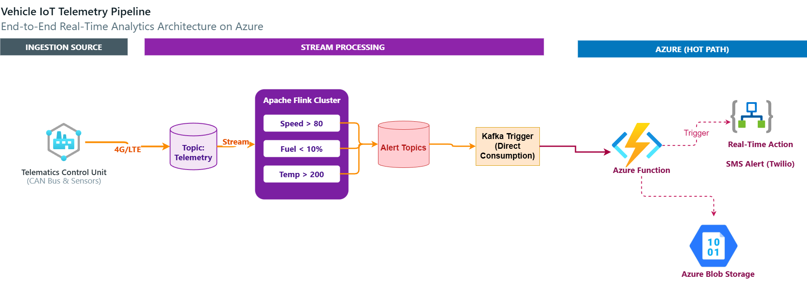
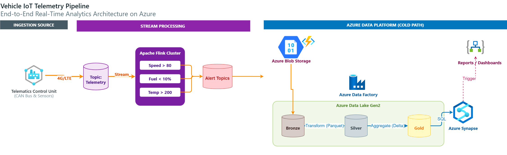

# 🚗 Vehicle Telemetry Azure Data Engineering Pipeline

A cloud-based data engineering project for processing vehicle telemetry data using separate **real-time (Hot Path)** and **batch/analytical (Cold Path)** processing architectures.

The project demonstrates how streaming telemetry events can be processed for real-time alerts while historical telemetry data can be stored and analyzed for deeper insights.

---

## 🏗️ Architecture Overview

The solution is divided into two processing paths:

### 🔥 Hot Path — Real-Time Processing

The Hot Path is designed for low-latency processing of incoming vehicle telemetry events.

```text
Vehicle Telemetry
       ↓
     Kafka
       ↓
 Azure Function
       ↓
Real-Time Processing / Alerts
```

This path is intended for use cases where telemetry needs to be processed immediately, such as vehicle fault detection and alert generation.

### ❄️ Cold Path — Historical / Analytical Processing

The Cold Path is designed for historical data processing and analytical workloads.

```text
Historical Vehicle Data
        ↓
 Azure Data Platform
        ↓
Azure Synapse Analytics
        ↓
SQL Analytics
```

This path supports historical analysis, aggregations, reporting, and fleet-level analytics.

---

## 📂 Project Structure

```text
vehicle_telemetry_azure_assets/
│
├── 1_hot_path/
│   ├── hot_path.drawio
│   ├── hot_path.png
│   │
│   ├── KafkaAlertFunction/
│   │   ├── __init__.py
│   │   └── function.json
│   │
│   └── requirements.txt
│
├── 2_cold_path/
│   ├── cold_path.drawio
│   ├── cold_path.png
│   └── synapse_queries.sql
│
└── README.md
```

---

## 🛠️ Technologies Used

- Python
- Apache Kafka
- Azure Functions
- Azure Synapse Analytics
- SQL
- Azure Cloud
- Draw.io

---

## 🔥 Hot Path

The Hot Path handles real-time vehicle telemetry events.

### Key concepts

- Event-driven processing
- Kafka-based streaming
- Azure Functions
- Real-time alert processing
- Low-latency data handling

### Potential use cases

- Vehicle fault alerts
- Abnormal telemetry detection
- Threshold-based alerts
- Real-time fleet monitoring

---

## ❄️ Cold Path

The Cold Path focuses on historical vehicle telemetry and analytical processing.

### Key concepts

- Historical data processing
- SQL analytics
- Data aggregation
- Fleet-level analysis
- Analytical workloads

### Potential use cases

- Vehicle performance analysis
- Historical telemetry analysis
- Fleet trends
- Operational reporting

---

## 📊 Architecture Diagrams

### Hot Path



### Cold Path



---

## 🎯 Project Objectives

This project demonstrates how a modern data engineering solution can separate workloads based on processing requirements:

- **Hot Path** → optimized for real-time events and alerts
- **Cold Path** → optimized for historical data and analytics

This architecture allows streaming and analytical workloads to be handled independently while supporting different latency requirements.

---

## 💡 Data Engineering Concepts Demonstrated

- Streaming data pipelines
- Batch data processing
- Event-driven architecture
- Kafka integration
- Azure serverless processing
- Cloud data engineering
- SQL-based analytics
- Real-time alerting
- Separation of hot and cold data paths

---

## 👨‍💻 Author

**Rupesh Karkera**

Data Engineering Enthusiast | Data Science Graduate

Focused on building real-world data engineering solutions involving:

- Data Pipelines
- Cloud Data Platforms
- ETL / ELT
- Streaming Systems
- Data Quality
- Workflow Automation

---

## 📌 Disclaimer

This repository is a portfolio project demonstrating a vehicle telemetry data engineering architecture and its supporting implementation assets.
